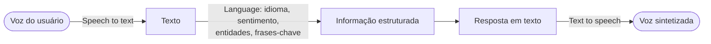

# Fala e linguagem com Azure: Speech Studio e Language Studio

Anotações do laboratório da [DIO](https://www.dio.me/) sobre **Azure AI Speech**
e **Azure AI Language**. O objetivo foi experimentar, sem escrever código, como
a IA da Microsoft **ouve, fala e entende texto**, usando o Speech Studio e o
Language Studio. Este repositório reúne o passo a passo, o que observei e o
que quero lembrar para usar esses serviços em projetos.

> [!NOTE]
> Os laboratórios oficiais da Microsoft (AI-900) foram atualizados e hoje
> usam o **Microsoft Foundry** ([ai.azure.com](https://ai.azure.com)) no lugar
> dos dois studios. O Speech Studio continua disponível
> ([aka.ms/speechstudio](https://aka.ms/speechstudio/)) e os serviços por baixo são os mesmos,
> então tudo o que está aqui também vale no Foundry. No fim há uma
> [comparação rápida](#studios--foundry).

## Sumário

- [Estrutura do repositório](#estrutura-do-repositório)
- [Conceitos](#conceitos)
- [Preparando o ambiente no Azure](#preparando-o-ambiente-no-azure)
- [Parte 1: Speech Studio](#parte-1-speech-studio)
- [Parte 2: Language Studio](#parte-2-language-studio)
- [Fazendo o mesmo com código](#fazendo-o-mesmo-com-código-opcional)
- [Studios × Foundry](#studios--foundry)
- [Limpeza e custos](#limpeza-e-custos)
- [Insights e aprendizados](#insights-e-aprendizados)
- [Referências](#referências)

## Estrutura do repositório

```text
.
├── README.md                  ← estas anotações
├── exemplos/
│   ├── audio/time.wav         ← áudio do laboratório oficial ("What time is it?")
│   └── textos/
│       ├── review1.txt … review4.txt         ← avaliações de hotel do laboratório oficial
│       ├── avaliacao-pt-positiva.txt         ← textos meus, em português
│       ├── avaliacao-pt-mista.txt
│       └── dados-pessoais-ficticios.txt      ← para testar PII (dados inventados)
├── scripts/                   ← o mesmo laboratório via SDK em Python (opcional)
│   ├── analisar_texto.py
│   ├── fala.py
│   └── requirements.txt
└── images/                    ← capturas de tela do laboratório
```

Os arquivos `review1.txt` a `review4.txt` e `time.wav` vêm do repositório
[MicrosoftLearning/AI-900-AIFundamentals](https://github.com/MicrosoftLearning/AI-900-AIFundamentals)
(licença MIT).

## Conceitos

| Termo | O que é |
|-------|---------|
| **Azure AI Speech** | Serviço de fala: transformar fala em texto, texto em fala, traduzir fala e avaliar pronúncia. |
| **Azure AI Language** | Serviço de linguagem natural (NLP): idioma, sentimento, frases-chave, entidades, dados pessoais, resumos, perguntas e respostas. |
| **Speech Studio / Language Studio** | Portais web para testar esses serviços **sem código** e depois copiar o código equivalente. |
| **Recurso (resource)** | O "serviço contratado" dentro da assinatura do Azure. Gera **endpoint** e **chaves** de acesso. |
| **Speech to text (STT)** | Reconhecimento de fala: áudio vira texto. |
| **Text to speech (TTS)** | Síntese de voz: texto vira áudio, com **vozes neurais** bem naturais. |
| **SSML** | Linguagem de marcação que controla a fala sintetizada (pausas, ênfase, velocidade, tom). |
| **Pontuação de confiança** | De 0 a 1, o quanto o modelo "acredita" na resposta. |



O diagrama mostra a ideia que costura o laboratório: **Speech** cuida da
entrada e da saída de voz, e **Language** entende o conteúdo no meio. É assim
que funcionam assistentes de voz e análises de call center.

## Preparando o ambiente no Azure

1. Entrar no [portal do Azure](https://portal.azure.com) (a conta gratuita serve).
2. Criar um **grupo de recursos** só para o laboratório, por exemplo `rg-lab-fala-linguagem`.
   Isso facilita apagar tudo no final.
3. Criar os recursos:
   - **Speech** (ou **Azure AI services**, que dá acesso a vários serviços com uma chave só);
   - **Language** (o assistente oferece recursos extras opcionais, que podem ser pulados).
4. Escolher uma **região** próxima, como *Brazil South* ou *East US*, e o tipo
   de preço **Free F0** quando estiver disponível (senão, **Standard S0**).
5. Em **Chaves e Ponto de Extremidade**, ficam a chave, a região e o endpoint.

> [!WARNING]
> A chave funciona como uma senha. Nunca deixe a chave em código, prints ou
> commits. Nos scripts deste repositório ela é lida de variáveis de ambiente.

## Parte 1: Speech Studio

Acesso: [speech.microsoft.com](https://speech.microsoft.com), fazendo login e
escolhendo o recurso de Speech criado.

### O que o Speech Studio oferece

| Grupo | Ferramenta | Para que serve |
|-------|------------|----------------|
| Fala → texto | **Real-time speech to text** | Arrastar um áudio ou usar o microfone e ver a transcrição na hora. |
| | **Batch speech to text** | Transcrever muitos áudios guardados em storage, de forma assíncrona. |
| | **Custom speech** | Treinar o reconhecimento com o vocabulário de uma área (termos médicos, nomes de produtos...). |
| | **Pronunciation assessment** | Dar nota de precisão, fluência e completude à pronúncia de quem fala. |
| | **Speech translation** | Traduzir a fala para outros idiomas com baixa latência. |
| Texto → fala | **Voice Gallery** | Ouvir as vozes neurais disponíveis em cada idioma e estilo. |
| | **Audio Content Creation** | Montar narrações sem código (audiolivro, vídeo, URA) ajustando pausas, ênfase e pronúncia. |
| | **Custom voice** | Criar uma voz própria a partir de gravações. |
| Soluções | **Captioning** | Legendas em tempo real ou offline, com filtro de palavrões. |
| | **Call Center** | Demonstração que junta Speech e Language: transcreve ligações, mascara dados pessoais e extrai sentimento. |
| | **Custom keyword** | Palavra de ativação, tipo "Ei, assistente". |

### Prática 1: fala em texto (Real-time speech to text)

1. **Real-time speech to text**, escolher o idioma (*English (United States)* para o áudio do laboratório).
2. Enviar [`exemplos/audio/time.wav`](exemplos/audio/time.wav) ou falar no microfone.
3. Observar:
   - a **transcrição** aparece em pedaços enquanto o áudio toca (resultados
     parciais) e depois é corrigida no resultado final;
   - a aba **JSON** mostra o resultado completo, com tempos de início e fim
     (*offset* e *duration*) e variações (*NBest*) com confiança;
   - pontuação e maiúsculas são colocadas automaticamente.
4. Repetir falando em **português** (*Portuguese (Brazil)*). Com o idioma
   errado selecionado, a transcrição sai sem sentido. O idioma precisa ser
   informado ou detectado (*language identification*).

### Prática 2: texto em fala (Voice Gallery)

1. **Voice Gallery**, filtrar por **Portuguese (Brazil)**.
2. Digitar um texto e ouvir vozes diferentes, como `pt-BR-FranciscaNeural` e
   `pt-BR-AntonioNeural`.
3. Testar **estilos** e velocidade nas vozes que suportam (alegre, triste,
   atendimento ao cliente...).
4. Em **Audio Content Creation**, inserir uma pausa e mudar a ênfase de uma
   palavra. Isso é o **SSML** sendo gerado por trás da interface.

Exemplo de SSML para testar:

```xml
<speak version="1.0" xml:lang="pt-BR">
  <voice name="pt-BR-FranciscaNeural">
    Olá! <break time="500ms"/> Este áudio foi gerado pelo
    <emphasis level="strong">Azure AI Speech</emphasis>.
    <prosody rate="-10%">Agora estou falando um pouco mais devagar.</prosody>
  </voice>
</speak>
```

### O que observei no Speech

- O reconhecimento lida bem com fala natural, mas **ruído, sotaque forte e
  termos técnicos** derrubam a precisão. É para isso que existe o *Custom speech*.
- As vozes **neurais** são muito mais naturais que as antigas. Para um
  atendimento, a escolha da voz e do estilo muda a percepção da marca.
- Toda ferramenta tem um botão para ver o **código de exemplo**, o que ajuda a
  sair do teste visual direto para uma aplicação.

## Parte 2: Language Studio

Acesso: [language.cognitive.azure.com](https://language.cognitive.azure.com),
fazendo login e escolhendo o recurso de Language.

### O que o Language Studio oferece

| Categoria | Funcionalidade | Exemplo de uso |
|-----------|----------------|----------------|
| Classificar texto | **Detect language** | Encaminhar o atendimento para a equipe do idioma certo. |
| | **Analyze sentiment and mine opinions** | Medir a satisfação em avaliações e saber **do que** o cliente gostou ou não. |
| | **Custom text classification** | Classificar chamados em categorias próprias. |
| Extrair informação | **Extract key phrases** | Ver os assuntos principais de milhares de comentários. |
| | **Find named entities (NER)** | Achar pessoas, lugares, organizações, datas e quantidades. |
| | **Find linked entities** | Ligar a entidade a um artigo da Wikipédia (desambiguação). |
| | **Extract PII** | Encontrar e mascarar dados pessoais (nome, e-mail, telefone, CPF...). |
| | **Text Analytics for health** | Entidades médicas: remédios, doses, sintomas. |
| Entender conversas | **Conversational language understanding (CLU)** | Identificar intenção e entidades em comandos ("agendar consulta amanhã"). |
| | **Custom question answering** | Base de perguntas e respostas a partir de FAQs. |
| Resumir | **Summarize text / conversation** | Gerar resumo de documentos ou de atendimentos. |

### Prática 3: análise das avaliações de hotel

Usei os quatro textos do laboratório oficial, em inglês, colando cada um em
**Analyze sentiment and mine opinions**, **Extract key phrases** e
**Find named entities**.

| Arquivo | Resumo do texto | O que esperar e o que observar |
|---------|-----------------|--------------------------------|
| [`review1.txt`](exemplos/textos/review1.txt) | "Good Hotel and staff": quartos limpos, ótima localização, restaurante com estrela Michelin. | Sentimento **positivo**. Entidades de **local** (London, Buckingham Palace, Westminster Abbey). |
| [`review2.txt`](exemplos/textos/review2.txt) | "Tired hotel with poor service": móveis velhos, internet que não funciona, longe do museu. | Sentimento **negativo**. A mineração de opinião aponta *internet* e *furnishings*. |
| [`review3.txt`](exemplos/textos/review3.txt) | "Good location... but on a busy road": elogios à localização e à equipe, reclamação do barulho. | Caso **misto**: o documento pode sair positivo, mas a análise **por frase** mostra a frase negativa sobre o barulho. |
| [`review4.txt`](exemplos/textos/review4.txt) | "Very noisy and rooms are tiny": barulho e quartos pequenos, mas limpos e bem localizados. | Predominantemente **negativo**, com frases positivas no fim. Uma boa amostra de por que olhar a análise por frase. |

O mais interessante foi comparar o **sentimento do documento** com o
**sentimento de cada frase** e com a **mineração de opinião**, que liga um
**alvo** ("rooms", "staff", "location") a uma **avaliação** ("clean",
"friendly", "tiny"). Uma nota única esconde exatamente a informação que o
hotel precisaria para melhorar.

### Prática 4: textos em português

| Arquivo | Funcionalidade | O que testar |
|---------|----------------|--------------|
| [`avaliacao-pt-positiva.txt`](exemplos/textos/avaliacao-pt-positiva.txt) | Detect language + sentimento | Idioma *Portuguese* com confiança alta e sentimento positivo. |
| [`avaliacao-pt-mista.txt`](exemplos/textos/avaliacao-pt-mista.txt) | Sentimento + opinião | Localização (positivo) × quarto e barulho (negativo) × atendimento (misto). |
| [`dados-pessoais-ficticios.txt`](exemplos/textos/dados-pessoais-ficticios.txt) | Extract PII | Nome, e-mail, telefone e data detectados e o **texto mascarado** com `*`. |

### O que observei no Language

- Cada resultado vem com **pontuação de confiança**. Numa aplicação real,
  vale definir um limite e mandar os casos duvidosos para revisão humana.
- Textos **curtos ou ambíguos** confundem a detecção de idioma. Nomes
  próprios e palavras estrangeiras também.
- A detecção de **PII** é um jeito simples de cumprir a LGPD antes de guardar
  ou mandar textos para outros sistemas.
- As funcionalidades **pré-treinadas** resolvem muita coisa sem treinar nada.
  As **personalizadas** (classificação, CLU, perguntas e respostas) exigem
  dados rotulados, mas se adaptam ao negócio.

## Fazendo o mesmo com código (opcional)

Os studios mostram o código equivalente. A pasta [`scripts/`](scripts) repete
o laboratório com os SDKs oficiais em Python:

```bash
pip install -r scripts/requirements.txt

# Language: idioma, sentimento + opiniões, frases-chave, entidades e PII
set LANGUAGE_ENDPOINT=https://<seu-recurso>.cognitiveservices.azure.com/
set LANGUAGE_KEY=<sua-chave>
python scripts/analisar_texto.py exemplos/textos/review3.txt exemplos/textos/dados-pessoais-ficticios.txt

# Speech: transcrever o áudio e gerar fala em português
set SPEECH_KEY=<sua-chave>
set SPEECH_REGION=<sua-regiao>
python scripts/fala.py transcrever exemplos/audio/time.wav
python scripts/fala.py falar "Olá! Esta voz foi gerada pelo Azure." saida.wav
```

No Linux ou macOS, troque `set` por `export`.

## Studios × Foundry

| | Speech Studio / Language Studio | Microsoft Foundry |
|---|---|---|
| Endereço | speech.microsoft.com / language.cognitive.azure.com | [ai.azure.com](https://ai.azure.com) |
| Foco | Um portal por serviço | Um portal único para modelos, agentes e serviços de IA |
| Fala | Ferramentas separadas (STT, TTS, tradução...) | Playgrounds de fala e **Voice Live**, que conversa por voz com um agente |
| Linguagem | Uma página por funcionalidade | Serviços em **Build → Services** (detecção de idioma, PII...) e comparação com modelos generativos |
| Laboratórios AI-900 atuais | — | [Speech](https://microsoftlearning.github.io/mslearn-ai-fundamentals/Instructions/Exercises/04a-speech.html) e [análise de texto](https://microsoftlearning.github.io/mslearn-ai-fundamentals/Instructions/Exercises/03b-text-analysis.html) |

## Limpeza e custos

- Ao terminar, apagar o **grupo de recursos** inteiro no portal do Azure
  (**Excluir grupo de recursos**). Assim nada fica cobrando.
- O tipo **F0** (gratuito) tem cota mensal limitada, suficiente para o
  laboratório. Só pode haver um recurso F0 de cada serviço por assinatura.

## Insights e aprendizados

1. **Fala + linguagem formam um pipeline.** Speech converte e Language
   entende. Juntos, viram assistente de voz, legenda automática ou análise de
   atendimento (a demonstração *Call Center* mostra exatamente isso).
2. **Testar no studio antes de programar** economiza tempo: dá para ver a
   qualidade com os meus próprios dados e já copiar o código pronto.
3. **Olhar além do rótulo.** A nota de sentimento do documento esconde
   detalhes. A análise por frase e a mineração de opinião mostram o porquê.
4. **Confiança não é certeza.** Toda saída é probabilística, então a
   aplicação precisa saber lidar com respostas de baixa confiança.
5. **Idioma importa.** Selecionar ou detectar o idioma certo é o primeiro
   passo para qualquer resultado bom, na fala e no texto.
6. **Privacidade desde o início.** Mascarar PII e proteger as chaves são
   cuidados simples que evitam problemas sérios.
7. **IA responsável:** vozes sintéticas realistas podem enganar. A Microsoft
   limita o *Custom voice* com acesso controlado, e é bom deixar claro para o
   usuário quando ele está ouvindo uma voz gerada por IA.

### Ideias de projetos

- Transcrever reuniões ou aulas e gerar um resumo com as frases-chave.
- Painel de satisfação a partir de avaliações, com os aspectos mais
  elogiados e mais criticados.
- Leitor de notícias em áudio com voz neural em português.
- Triagem de e-mails de suporte: idioma, sentimento e mascaramento de PII
  antes de abrir o chamado.

## Referências

- [Visão geral do Speech Studio](https://learn.microsoft.com/azure/ai-services/speech-service/speech-studio-overview)
- [O que é o Azure AI Speech](https://learn.microsoft.com/azure/ai-services/speech-service/overview)
- [O que é o Azure AI Language](https://learn.microsoft.com/azure/ai-services/language-service/overview)
- [Laboratórios AI-900 atuais (Microsoft Foundry)](https://microsoftlearning.github.io/mslearn-ai-fundamentals/)
- [Laboratórios AI-900 anteriores (arquivados)](https://microsoftlearning.github.io/AI-900-AIFundamentals/)
- [GitHub Quick Start (DIO)](https://github.com/digitalinnovationone/github-quickstart)
- [Formação Fundamentos de GitHub (GitBook)](https://aline-antunes.gitbook.io/formacao-fundamentos-github)
- [Documentação do GitHub](https://docs.github.com/pt)
- [Sintaxe básica de escrita e formatação no GitHub](https://docs.github.com/pt/get-started/writing-on-github/getting-started-with-writing-and-formatting-on-github/basic-writing-and-formatting-syntax)
